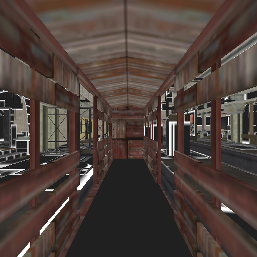
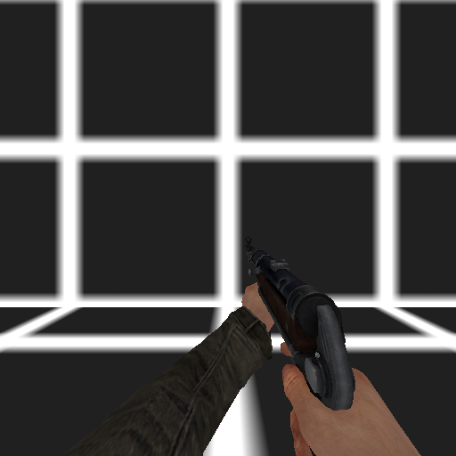

# Wolfenstein (2009) SP

An open-source C++ engine project for the Wolfenstein (2009) single-player
campaign. Android is the first target; iOS and WebAssembly are planned.
It builds on [idTech4A++](https://github.com/glKarin/com.n0n3m4.diii4a) and reads
data from your own PC copy of the game.

**Early development: the full campaign is not playable.** The native engine
can load the opening of trainyard, carry the player in the original wagon and
reach its arrival event. Player and MP40 behavior, scripted actor animation and
other components have separate native tests. No complete mission is supported.

[Download APK 0.10](https://github.com/CheffCorleOne/wolf2009-sp/releases/tag/v0.10.0-engine-dev)
· [Android setup](docs/ANDROID.md) · [Current checkpoint](docs/CHECKPOINT.md)
· [Next steps](docs/NEXT-STEPS.md)

| Trainyard through the native player camera | Original MP40 in the native weapon test |
|:---:|:---:|
|  |  |

Actual 512×512 GLES captures from Android 15 x86_64 tests. Trainyard uses a
partial diffuse-material path; lighting, effects and retail visual parity are
unfinished. The MP40 frame comes from the separate `empty` test map.
[Capture provenance and reload frame](docs/images/README.md).

## What works

| Area | Validated scope |
|---|---|
| Game data | SP PK4 and SPK/MPK readers; compiled declarations, entities, meshes, textures, skeletons and spline clips |
| Native runtime | GPL engine/game startup, source maps, player physics, render-world and resource teardown |
| Player and MP40 | Movement, jumping, crouch physics, firing, damage, ammo and reload in isolated native tests |
| Trainyard | Original world/wagon collision, moving-platform carry and arrival; newer C++ tests also show three boxcars and exercise the relay's own use key |
| Scripted actor | Original 52-joint greeter body, authored skin and 182-frame clip; real animator start, endpoint and stale-identity refusals |
| Animated door | Original two-joint door bound to the moving wagon; real owner-authorized start, endpoint and stale/replacement tests in isolated `empty` fixtures |

The released **APK 0.10** contains the earlier trainyard intro. Its normal
folder picker currently prepares **`empty` only**; trainyard needs explicit
[developer staging](docs/ANDROID.md#developer-staging-for-trainyard). It starts unarmed, has no
crouch button and runs with sound disabled. Newer actor/arrival/door tests are C++
development work, not features of that APK.

AI, navigation, dialogue, the complete door/greeting event chain, mission
progression and campaign save/load remain unfinished. Reading every archive
does not make its gameplay executable. See [validation results](docs/CHECKPOINT-VALIDATION.json)
for the tested scope.

## Build and contribute

Start with [development](docs/DEVELOPMENT.md), [engine builds](docs/ENGINE.md)
and [next steps](docs/NEXT-STEPS.md). [AGENTS.md](AGENTS.md) records the same
evidence, ownership and integration rules for AI contributors.

The Node inventory tests need Node.js 22+ and no npm dependencies:

```powershell
npm test
```

For the portable archive tools on Windows with Zig 0.15.2:

```powershell
.\tools\build-native.ps1 -Zig 'C:\path\to\zig.exe'
npm run test:native
```

Engine changes belong in the shared C++ loaders and native adapters. Useful
next contributions include whole-bank audio registration, measured BRAI action
handlers, native lifecycle tests and physical Android ARM64 testing. Please
include a reproducible case and distinguish a parser result from a playable
gameplay result. [Roadmap](docs/ROADMAP.md) · [Research notes](docs/RESEARCH.md).

## Source and game data

Project code is [GPL-3.0-or-later](LICENSE). Upstream revisions and third-party
licenses are recorded in [PROVENANCE.json](docs/PROVENANCE.json).
The original Windows game DLL is not loaded by this engine.

The repository and APK contain no original game archives or binaries. You
must supply your own game data. Screenshot artwork belongs to its respective
rights holders; the source-code license does not license that artwork.
This is an independent community project.
