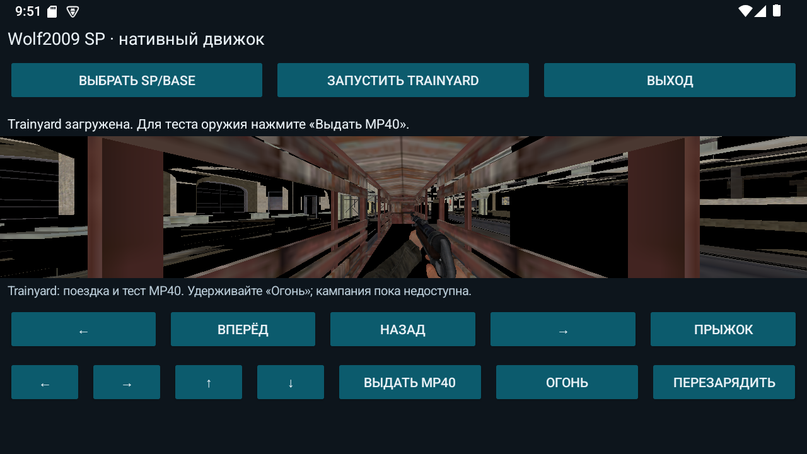

# Android

The [v0.13.0-engine-dev APK](https://github.com/CheffCorleOne/wolf2009-sp/releases/tag/v0.13.0-engine-dev) (version code `14`, source `f2b450d`, SHA-256 `01847be7c59576103ff89d3ac43dee1add6ced351b51a77e590a0bab40ac25a9`) adds the native AAS and whole-bank audio to the production engine. Stage trainyard with `tests/engine-android/Stage-EngineData.ps1 -WithTrainyardGreeterRoute` to run the greeter route: wagon door, run to the ladder and the native trapdoor. It was released without an on-device smoke test; the chain passed the native QA runs listed in [CONTINUE](CONTINUE.md).

The [v0.11.0-engine-dev APK](https://github.com/CheffCorleOne/wolf2009-sp/releases/tag/v0.11.0-engine-dev) (version code `12`, source `78cf2c9`) supports manual MP40 equip, fire and reload in developer-staged trainyard. These controls passed on an Android 15 x86_64 emulator with SwiftShader GLES3. The APK uses resources from your own PC copy; no mission is playable from start to finish yet.

Verified APK SHA256:

```text
df8b78db0ae07e2e2138df1e2bde97d60592183f03a61f3b2de3379666aad9e6
```

The earlier published [v0.10.0-engine-dev APK](https://github.com/CheffCorleOne/wolf2009-sp/releases/tag/v0.10.0-engine-dev), source `55fe192`, was installed and tested with sound disabled. Its SHA256 was:

```text
2b75bc10322aebdc913225471b0bbe744fe3e3f015a259d38420b0b32daec008
```

## Requirements and tested scope

- Android 8.0 / API 26 or newer, with OpenGL ES 3.0.
- Packaged ABIs: `arm64-v8a` and `x86_64`.
- Actual runtime validation: Android 15 x86_64 emulator. Physical ARM64 hardware, iOS and WebAssembly remain untested.
- Original game data from your own Wolfenstein 2009 SP installation. The APK contains independently authored compatibility support, without commercial game archives.

Native arrival, actor and door component checks are separate from manual APK mission progression. See [TRAINYARD](TRAINYARD.md) for their tested scope.

## Try the APK

1. Install the engine APK for the version you intend to test.
2. Make `SP/base/assets.pk4` and `SP/base/maps/game/empty/empty.mpk` available on the device, preserving their relative folders.
3. Open the launcher's folder picker and select `SP/base`, its `SP` parent, or the installation root. The launcher labels are currently Russian. Import creates a private copy of those two archives and leaves the original files untouched.
4. Start `empty`. The original test map has blue grid textures. Walk with the movement buttons, look by dragging the viewport or using the look arrows, and use the jump button.
5. Exit through the launcher; reopen the app for another run.

The player starts with `weapon_none`. The empty import contains no MP40 resources, so the weapon buttons stay disabled. The touch UI has no crouch button. Movement and action controls occupy two rows below the viewport.

SAF import currently selects **empty only**. Importing again switches a developer-staged trainyard selection back to empty. If the app is backgrounded during initial native loading, its separate engine process may exit; reopen the app. Imported data remains available.

## Developer staging for trainyard

This post-install helper currently targets the dedicated `emulator-5556` only. It reads your original installation, prepares private app data and verifies transferred hashes. It neither installs nor launches an APK.

Set `WOLF2009_GAME_ROOT` to your own installation or `SP/base`, and `WOLF2009_SUPPORT_BASE` to the generated `assets/engine-support/base` directory recorded in the APK build report. Run from the repository root:

```powershell
.\tests\engine-android\Stage-EngineData.ps1 `
  -GameRoot $env:WOLF2009_GAME_ROOT `
  -SupportBase $env:WOLF2009_SUPPORT_BASE `
  -Serial emulator-5556 -WithTrainyard
```

The helper needs these six original inputs:

```text
assets.pk4
maps/game/empty/empty.mpk
maps/game/trainyard/trainyard.mpk
maps/game/global/global.spk
maps/game/trainyard/trainyard_vo_english.spk
streampacks/mp40.spk
```

`prepare-source-session.mjs` also extracts the two compiled global declaration catalogs from the owner's `assets.pk4`, writes the source-session descriptor, and publishes `owner.ready` / `trainyard.ready` after preparation. Commercial bytes stay in ignored local staging and the app's private directory.

Reopen the launcher and start trainyard. Use the manual weapon controls:

1. After the prepared map starts, tap **Give MP40** (`Выдать MP40`). This development command equips a fresh weapon with clip `32` and reserve `32`.
   This describes APK 0.11. Since the M3/M4 pickups work, `wolf2009DevEquipMP40` refuses unless the cheat cvar `wolf2009_qaDevWeaponGrant` is `1`. A later APK built from `main` must enable that cvar, or the button only logs a refusal. The ordinary route to the MP40 is the original pickup.
2. Hold **Fire** (`Огонь`), then release it. Check that shots consume the clip and stop after release.
3. Tap **Reload** (`Перезарядить`) and wait for the native reload to complete. Check that ammunition moves from reserve into the clip.
4. Tap Give MP40 again when you need fresh `32/32` ammunition. This is a development reset, not a source pickup.

Keyboard bindings are `M` for Give, mouse1 for fire and `R` for reload. `F8` runs the read-only `wolf2009WeaponStatus` command, which logs the actual source weapon, clip/reserve, phase, view owner, attack input and native shot/reload counters.

The final APK produced these native results on Android 15 x86_64 / SwiftShader:

| Action | Observed state |
|---|---|
| Give MP40 | Clip `32`, reserve `32`, native view owner present |
| Hold and release Fire | Nine shots, clip `23`; attack input returned to zero and the shot count stayed unchanged for one second |
| Reload | Actual `Reloading` phase, then clip `32`, reserve `23`, reload count `1`; reloading a full clip changed no ammunition |
| Home/return while firing | Same engine process, zero attack input and a stable shot count after return |
| Exhaust clip, then Give again | Clip `0`, one empty click; Give restored `32/32` with fresh counters |

Ordinary Exit ended the engine process. All nine hashed staged archive/preferences files were preserved through the update installation and test session.



The host now sets `s_noSound=0` so the native reload sample cache can load. Audible output is untested; complete weapon and VO audio are unfinished. Door, greeter, enemies and campaign progression are not available through this manual slice. Keep the automated `engineQa` option off for manual trainyard: its wall/view assertions are for empty.

## Build an engine APK

The Windows helpers use PowerShell 7, Git, Node 22+, JDK 21, Android CMake 3.22.1, NDK `30.0.16248370`, API 37 and build-tools 37.0.0. An existing local debug keystore is required; pass `-KeyStore` if needed and keep signing material out of Git.

```powershell
.\tools\install-android-sdk.ps1 -Engine
.\tests\engine-runtime\Build-EngineRuntime.ps1 -Abi arm64-v8a -WithWolfAnimation -Jobs 1
.\tests\engine-runtime\Build-EngineRuntime.ps1 -Abi x86_64 -WithWolfAnimation -Jobs 1
.\tools\build-engine-apk.ps1
```

Production inputs require `WOLF2009_ANIMATION=ON` and every `WOLF2009_*_QA=OFF`. The builder rejects stale or mismatched core/game inputs and checks both ABIs, signature, ELF/ZIP 16 KiB alignment and the package allowlist. Output: `build/android-engine/wolf2009-sp-0.11.0-engine-dev.apk`. A local rebuild does not inherit another artifact's hash or runtime validation.

See [ENGINE](ENGINE.md) for native builds and [the Android host notes](../tests/engine-android/README.md) for explicit QA. The older viewer builder is a separate tool; use `build-engine-apk.ps1` for this engine host.
