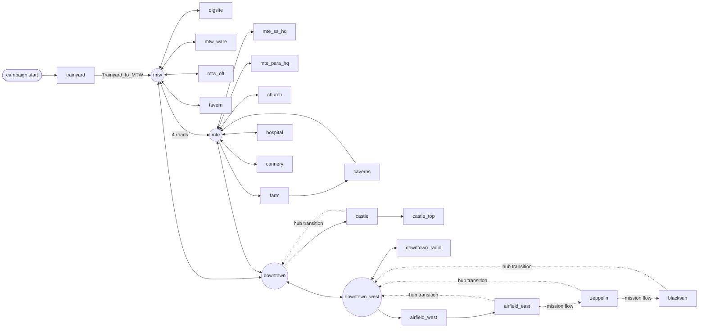

# Campaign reverse-engineering map

Reviewed 2026-11-09. This page inventories what the shared engine must implement
for the Wolfenstein (2009) single-player campaign, and in which order. It joins
the original mission, map, brain and entity data with the hash-identified
`Gamex86.dll` (`7cb1cbed…2d47`) and with what this repository already runs.
**It is a work plan, not a compatibility claim.** No mission is playable; see
[CHECKPOINT](CHECKPOINT.md).

The machine-readable table is [CAMPAIGN-RE.json](CAMPAIGN-RE.json). It lists
every used brain node type and condition, every unused descriptor, every native
class and ENTS classname, with per-map counts, first map, status and the DLL
procedure that still needs reading. It contains names, counts and addresses
only: no binary bytes, disassembly or pseudocode.

Labels follow [TRAINYARD-CHAIN](TRAINYARD-CHAIN.md): **Data** (original
ENTS/BRAI/def bytes), **Static** (inspected DLL code or tables, no execution),
**Inferred**, **Unknown**. Entity definitions and mission data come from the
editor `.def` text inside `assets.pk4`; their equivalence with the compiled
`.decls` the runtime loads ([DECLARATIONS](DECLARATIONS.md)) was not checked.

## 1. Inputs and totals

| Input | Count |
|---|---|
| Map packs (`SP/base/maps`, 26 under `game/` plus `tools/mv2`) | 27 MPK |
| ENTS entities / classnames / native spawn classes | 56,139 / 1,335 / 158 |
| BRAI graphs / nodes / outputs | 633 / 14,147 / 13,158 |
| Distinct node types / distinct condition types used | 154 / 51 |
| DLL descriptors (Task / Condition), all with an RTTI vftable | 282 / 115 |
| Mission definitions in `mission_library` | 15 missions, 23 filler objectives, 1 demo |

Only 23 packs carry campaign content. `menu` is the front end, `empty` and
`soundtest` are test maps and `tools/mv2` is a tool map. The `.def` text also
declares `game/intro/intro` and `game/demo/demo_trainyard`; neither pack is
installed (**Data**).

## 2. Missions, hubs and transitions

### 2.1 Mission chain (Data: `def/missions/*.def`)

| # | Mission | Maps | Requires | Given by | Enter via | Leave via (destination) |
|---:|---|---|---|---|---|---|
| 001 | `mission_trainyard` Train Station | trainyard | — | trainyard `target_mission_give_1` | campaign start | `Trainyard_to_MTW` (mtw) |
| 002 | `mission_digsite` Dig Site | digsite | trainyard | mtw brain `digsite_briefing_runner` | `MTW_to_Digsite` | `Digsite_to_MTW` (mtw) |
| 013 | `mission_warehouse` Warehouse (side) | mtw_ware | digsite | mtw `mtside_1000` | `MTW_to_MTW_Ware` | `MTW_Ware_to_MTW` |
| 011 | `mission_ssbase` SS Headquarters (side) | mte_ss_hq | digsite | mte `mtside_3000` | `MTE_to_SS_HQ_Transition` | `SS_HQ_to_MTE_Transition` |
| 005 | `mission_church` Church | church | digsite | mtw `caroline_giver`; church `target_mission_give` | `MTE_to_Church_Transition` | `Church_to_MTE_Transition` |
| 004 | `mission_crystalfactory` Farm | farm, caverns | digsite | tavern `bar_5000`; farm `target_mission_give` | `MTE_to_Farm_Transition` | `Caverns_to_MTE_Transition` |
| 003 | `mission_hospital` Hospital | hospital | digsite | mte `la_post_missions` | `MTE_to_Hospital_Transition` | `Hospital_to_MTE_Transition` |
| 014 | `mission_officershouse` Officer's House (side) | mtw_off | warehouse | mtw `kc1_5000` | `MTW_to_MTW_Off` | `MTW_Off_to_MTW` |
| 012 | `mission_parabase` Paranormal Base (side) | mte_para_hq | ssbase | mte `gd1_5000` | `MTE_to_Para_HQ_Transition` | `Para_HQ_to_MTE_Transition` |
| 006 | `mission_cannery` Cannery | cannery | hospital, crystalfactory, church | mtw `caroline_pre_cannery`; cannery entity | `MTE_to_Cannery_Transition` | `Cannery_to_MTE_Transition` |
| 007 | `mission_castle` Castle | castle, castle_top | cannery | downtown `dt_2_missiongiver_castle` | `Downtown_to_Castle_Transition` | `Castle_to_Downtown_Transition` (downtown) |
| 110 | `mission_radiotower` Radio Station (side) | downtown_radio | cannery | downtown `dt_2_missiongiver_radio` | `Downtown_to_Radio_Transition` | `Radio_to_Downtown_Transition` (downtown_west) |
| 008 | `mission_airfield` Airfield | airfield_west, airfield_east | cannery | downtown `dt_2_missiongiver_airfield` | `Downtown_to_Airfield_West_Transition` | `Airfield_East_to_Downtown` (downtown_west) |
| 009 | `mission_zeppelin` Zeppelin | zeppelin | airfield | zeppelin `target_mission_give_zeppelin` | `Airfield_East_to_Zeppelin_Transition` | `Zeppelin_to_Downtown` (downtown_west) |
| 010 | `mission_blacksun` Black Sun | blacksun | zeppelin | — (no giver found) | `Zeppelin_to_Black_Sun_Transition` | `Blacksun_to_Downtown` (downtown_west) |

"Given by" lists BRAI `MissionGive` (type 200) nodes whose `mMission` names the
mission, and ENTS `target_mission_give` entities. Story missions carry
`isStoryMission 1`; the five side missions do not. Filler missions (indices
300–324) are hub objectives gated by global-variable expressions such as
`(mission_trainyard_complete == 1) && (mission_filler_mt_bm_1_complete == 0)`.

### 2.2 Hubs (Data: `def/mapadjacency.def`)

Isenstadt has three hub districts: **Midtown West** (`mtw`, hubID 0, with
trainyard, digsite, warehouse, officer's house and tavern), **Midtown East**
(`mte`, hubID 1, with SS base, paranormal base, church, farm/caverns, hospital
and cannery) and **Downtown** (`downtown` plus `downtown_west`, hubID 2, with
castle, radio, airfield, zeppelin and blacksun). `mtw` and `mte` connect by four
road triggers each way; both connect to `downtown`.

### 2.3 How maps change

There are 51 `map_transition.def` entries, each with `mapPack`, detail packs and
a `warp` entity name in the destination (**Data**). Two mechanisms use them:

1. **ENTS triggers (Data).** 32 `trigger_stream` entities (`rvTrigger_Stream`)
   carry `def_mapTransition`. They cover every hub-to-hub road, hub-to-mission
   entries and the in-mission pack changes `castle → castle_top`,
   `farm → caverns` and `airfield_west → airfield_east`.
   `Church_to_MTE_Transition` is the only mission exit implemented this way.
2. **Mission flow (Inferred).** The other 19 entries are named only by mission
   `def_hubTransition` / `def_mapTransition` keys or by nothing. Every mission
   exit except church's is in this group, as are `Airfield_East_to_Zeppelin` and
   `Zeppelin_to_Black_Sun`. The native mission manager (`rvMission`, Unknown)
   presumably fires them on completion. Trainyard's end supports this: ENTS
   1745 `target_scaleformplayvideo_1` plays `videos/trans_tra2mid` with
   `statsScreenLoadImmediately 1` and targets `target_objective_success_9`
   (Data). Cannery's exit video sets `endOfLevel 1`.

`Intro_to_Trainyard` warps to `intro_to_trainyard_respawn`, which exists in
trainyard, but no installed map references it. The front end's first replay
cinematic is `videos/wolf_campaign_start`. **Inferred:** a new campaign plays
that video and loads trainyard directly.

### 2.4 Campaign order used below

The order below drives "first map that needs it". It is **Inferred**. It
respects every `req_mission` chain, places hubs at first access and side
missions at their first unlock, and matches the designer-ordered
`ReplayCinematics` list (19 cinematics, Data): campaign start, briefing, digsite
×2, warehouse, MTE interrogation, church, tavern, hospital ×2, Black Sun
glimpse, cannery, castle, power transmitters, airfield, zeppelin, Black Sun ×3.
Players may legally visit side missions and the post-digsite missions in other
orders.

| # | Map | Role | Mission | Entities | Brain graphs | Nodes | New node types | New conditions | New native classes |
|---:|---|---|---|---:|---:|---:|---:|---:|---:|
| 0 | trainyard | story | mission_trainyard | 2238 | 16 | 822 | 61 | 20 | 65 |
| 1 | mtw | hub | — | 5659 | 133 | 3997 | 34 | 19 | 26 |
| 2 | digsite | story | mission_digsite | 2767 | 26 | 306 | 10 | 5 | 11 |
| 3 | mtw_ware | optional | mission_warehouse | 666 | 4 | 132 | 1 | 1 | 0 |
| 4 | mte | hub | — | 4864 | 66 | 2174 | 1 | 1 | 1 |
| 5 | mte_ss_hq | optional | mission_ssbase | 1158 | 6 | 72 | 1 | 0 | 4 |
| 6 | church | story | mission_church | 2938 | 29 | 687 | 11 | 1 | 7 |
| 7 | tavern | hub | — | 366 | 28 | 548 | 0 | 0 | 0 |
| 8 | hospital | story | mission_hospital | 4397 | 47 | 610 | 6 | 1 | 12 |
| 9 | farm | story | mission_crystalfactory | 1912 | 7 | 107 | 0 | 0 | 3 |
| 10 | caverns | story | mission_crystalfactory | 4370 | 35 | 733 | 6 | 1 | 4 |
| 11 | mtw_off | optional | mission_officershouse | 1091 | 6 | 144 | 0 | 0 | 0 |
| 12 | mte_para_hq | optional | mission_parabase | 512 | 5 | 138 | 1 | 0 | 0 |
| 13 | cannery | story | mission_cannery | 3518 | 32 | 510 | 6 | 0 | 5 |
| 14 | downtown | hub | — | 3831 | 82 | 1876 | 6 | 1 | 3 |
| 15 | castle | story | mission_castle | 1650 | 3 | 9 | 1 | 0 | 0 |
| 16 | castle_top | story | mission_castle | 2671 | 16 | 381 | 3 | 0 | 7 |
| 17 | downtown_west | hub | — | 685 | 3 | 52 | 0 | 0 | 0 |
| 18 | downtown_radio | optional | mission_radiotower | 2095 | 14 | 171 | 1 | 0 | 0 |
| 19 | airfield_west | story | mission_airfield | 2304 | 26 | 188 | 0 | 0 | 1 |
| 20 | airfield_east | story | mission_airfield | 1635 | 8 | 91 | 1 | 1 | 1 |
| 21 | zeppelin | story | mission_zeppelin | 3536 | 40 | 392 | 4 | 0 | 0 |
| 22 | blacksun | story | mission_blacksun | 1221 | 1 | 7 | 0 | 0 | 7 |
| 23 | menu | frontend | — | 43 | 0 | 0 | 0 | 0 | 0 |
| 24 | empty | test | — | 2 | 0 | 0 | 0 | 0 | 0 |
| 25 | soundtest | test | — | 3 | 0 | 0 | 0 | 0 | 0 |
| 26 | tools_mv2 | tool | — | 7 | 0 | 0 | 0 | 0 | 1 |

## 3. Brain node types and conditions

### 3.1 Method slots (Static)

Every one of the 282 task and 115 condition descriptors has an MSVC RTTI
vftable named `rvBrain::<Name>`. Comparing them with the base `rvBrain::Task`
and `rvBrain::Condition` vftables, the activation (`201dd3f0`), Tick
(`201df480`), root dispatch (`201ddce0`) and Reset (`201df7a0`) call sites
establish these roles:

| Offset | Task | Condition |
|---|---|---|
| `+0x04` | Initialize (10 overrides) | Initialize |
| `+0x08` | **Enter** (215 overrides; 67 no-ops) | Enter (re-arm, e.g. Timer) |
| `+0x0c` | Exit (11 overrides) | Exit (no-op in all 115) |
| `+0x18` | Bind, called by Reset | Bind |
| `+0x28` | primary-condition getter (54 tasks with an embedded condition) | **Evaluate** |
| `+0x2c` | polled on roots during root dispatch (22 overrides) | — |

The network Tick calls no per-frame Task method. A durable task such as GoTo,
Say or Animate starts work in its owning actor or entity subsystem at Enter.
The network observes completion only through conditions (Reached, SayFinished,
AnimFinished). Each node type therefore needs a bounded Enter/Exit contract plus
the conditions that read its subsystem state. A per-task update loop is not part
of that contract. Wait (type 30) and all roots have no-op Enters; their behavior
is their embedded condition.

For every non-trivial Enter (tasks) or Evaluate (conditions), the JSON records
the instruction count, the classes the procedure dynamic-casts to (from RTTI
type-descriptor operands), and its virtual-call offsets. Example: UseTarget
Enter `201ed440` calls entity slot `+0x24c` (Use). These are hints that
show where to read next. They are not recovered calling contracts. The
`mainProcedure` hint can belong to another method than Enter: for
GoToAndFaceTarget the `+0x45c`/`+0x460` calls are in Exit `201f15d0`, while
Enter `201f1420` starts the scripted move ([AI-ACTOR](AI-ACTOR.md)).

### 3.2 Brain kernel features (Data)

| Feature | Uses | First map | Status |
|---|---:|---|---|
| Normal outputs (flag 16) | 11,045 | trainyard | implemented (BrainFlow/BrainTask) |
| Probe outputs (flag 32) | 2,102 | trainyard | portable `ProbeLeafPassV1`; native greeter probes still refused |
| Once outputs (flags 17 / 33) | 9 / 2 | mtw / mte | normal once implemented; probe once not |
| Outputs with several conditions | 1,065 | trainyard | AND short-circuit implemented |
| Multi-destination / nonzero weights | 205 / 123 | trainyard | selector implemented |
| Wait unit `0` / `1` | 1,669 / 185 | trainyard | literal ms in the generic host; measured 6000 ms and one-second waits in `MeasuredTrainyardExitV1` |
| Stack mode (`0x40`), non-unit decay | 0 / 0 | — | not used by shipped graphs |

### 3.3 Most used node types

Status: **runtime-tested** means a native handler ran in an Android x86_64
session, usually under one measured profile. **contract** means a Static
contract exists but no general handler. **unknown** means only the descriptor
name, description, Enter address and usage are known. "Needs" is the evidence
still required. **one procedure:** a bounded Enter/Evaluate read of 120
instructions or fewer, with no actor-class cast. **subsystem RE:** the procedure
casts to `idAI`, `idActor`, `rvVehicle`, `rvDoor`, `idMover`, `idSound` or
`idAnimated`, or is larger, so the native subsystem behind it must also be
recovered. **primary condition:** a no-op Enter whose behavior is the embedded
condition. The full table of all 154 types is in the JSON.

| ID | Node type | Uses | Graphs | First map | System | Enter | Status | Needs |
|---:|---|---:|---:|---|---|---|---|---|
| 30 | Wait | 1539 | 308 | trainyard | brain-core | no-op | runtime-tested | — |
| 68 | UseTarget | 1373 | 222 | trainyard | entity-scripting | `0x201ed440` | runtime-tested | — |
| 3 | OnUsed | 1336 | 419 | trainyard | brain-core | no-op | runtime-tested | — |
| 51 | Animate | 1251 | 276 | trainyard | ai-scripted | `0x201f5290` | contract | implement ([AI-PRESENTATION](AI-PRESENTATION.md)) |
| 12 | Say | 991 | 213 | trainyard | audio-speech | `0x201f5e90` | contract | implement ([AI-PRESENTATION](AI-PRESENTATION.md)) |
| 464 | UseAllTargets | 890 | 125 | mtw | entity-scripting | `0x201ed570` | unknown | one procedure |
| 195 | SetLocalVariable | 613 | 97 | mtw | brain-core | `0x201e53f0` | unknown | one procedure |
| 1 | OnSpawn | 449 | 408 | trainyard | brain-core | no-op | runtime-tested | — |
| 289 | EnableRootTask | 429 | 119 | trainyard | brain-core | `0x201e1e90` | unknown | one procedure |
| 54 | AnimOverrideIdle | 377 | 170 | trainyard | ai-scripted | `0x201f5930` | unknown | subsystem RE |
| 19 | ScriptedVOStreamIn | 372 | 180 | trainyard | audio-speech | `0x201f6560` | runtime-tested | — |
| 490 | ScriptedVOStreamOut | 340 | 174 | trainyard | audio-speech | `0x201f6740` | unknown | one procedure |
| 52 | WatchTarget | 311 | 89 | trainyard | ai-scripted | `0x201f5670` | unknown | subsystem RE |
| 33 | SetScriptedManual | 286 | 195 | trainyard | ai-scripted | `0x201f7190` | unknown | subsystem RE |
| 220 | SetGlobalVariable | 214 | 99 | mtw | brain-core | `0x201e75c0` | runtime-tested | — |
| 188 | EndBranch | 209 | 142 | trainyard | brain-core | `0x201e0030` | unknown | one procedure |
| 70 | RemoveTarget | 189 | 79 | trainyard | entity-scripting | `0x201ed7d0` | runtime-tested | — |
| 99 | EnableMovement | 181 | 52 | mtw | ai-scripted | `0x201f08e0` | unknown | subsystem RE |
| 49 | IgnoreEnemiesSet | 150 | 63 | trainyard | ai-combat | `0x201f2c60` | unknown | subsystem RE |
| 15 | StopSpeaking | 130 | 66 | mtw | audio-speech | `0x201f6420` | contract | implement ([AI-PRESENTATION](AI-PRESENTATION.md)) |
| 154 | Show | 126 | 34 | trainyard | entity-scripting | `0x201fae60` | unknown | one procedure |
| 23 | GoTo | 121 | 71 | trainyard | navigation | `0x201eeac0` | unknown | subsystem RE |
| 403 | StartRemovalAttempt | 116 | 29 | trainyard | ai-scripted | `0x201f7b40` | unknown | subsystem RE |
| 4 | OnActionKeyed | 104 | 100 | mtw | brain-core | no-op | unknown | primary condition |
| 132 | MoveToEnt | 103 | 29 | trainyard | physics-movers | `0x201f7fc0` | runtime-tested | — |
| 290 | EnableAllRootTasks | 103 | 53 | mtw | brain-core | `0x201e1f50` | unknown | one procedure |
| 24 | FaceTarget | 102 | 59 | trainyard | navigation | `0x201eefa0` | unknown | subsystem RE |
| 243 | GoToAndFaceTarget | 92 | 33 | trainyard | navigation | `0x201f1420` | unknown | subsystem RE |
| 123 | GoToNoStop | 86 | 34 | trainyard | navigation | `0x201eed80` | unknown | subsystem RE |
| 7 | OnCombat | 82 | 62 | trainyard | ai-combat | no-op | unknown | primary condition |
| 8 | OnDeath | 78 | 73 | mtw | ai-combat | no-op | unknown | primary condition |
| 97 | LockLocation | 71 | 19 | trainyard | ai-scripted | `0x201f06f0` | unknown | subsystem RE |
| 43 | Hunt | 61 | 31 | trainyard | ai-combat | `0x201f2890` | unknown | subsystem RE |
| 140 | Rotate | 58 | 15 | digsite | physics-movers | `0x201f9cf0` | unknown | one procedure |
| 253 | SetUndying | 58 | 29 | trainyard | entity-scripting | `0x201f2fa0` | unknown | subsystem RE |
| 112 | OnPain | 55 | 45 | trainyard | ai-combat | no-op | unknown | primary condition |
| 499 | EnableSpeaker | 54 | 3 | trainyard | audio-speech | `0x20214150` | unknown | subsystem RE |
| 495 | StopAllSpeakingAI | 50 | 40 | mtw | audio-speech | `0x201e69d0` | unknown | one procedure |
| 122 | OnPlayerLeftSpeechRange | 49 | 36 | mtw | audio-speech | no-op | unknown | primary condition |
| 75 | SetUsable | 48 | 10 | trainyard | entity-scripting | `0x201ed890` | unknown | one procedure |

### 3.4 Most used conditions

| ID | Condition | Uses (embedded/explicit) | First map | System | Evaluate | Status | Needs |
|---:|---|---|---|---|---|---|---|
| 65 | Timer | 2070 (1854/216) | trainyard | brain-core | `0x201e7f50` | runtime-tested | — |
| 50 | AnimFinished | 1440 (1251/189) | trainyard | ai-scripted | `0x201ebe70` | contract | implement ([AI-PRESENTATION](AI-PRESENTATION.md)) |
| 64 | Used | 1336 (1336/0) | trainyard | brain-core | `0x201e4400` | runtime-tested | — |
| 10 | SayFinished | 1009 (991/18) | trainyard | audio-speech | `0x201ec1e0` | contract | implement ([AI-PRESENTATION](AI-PRESENTATION.md)) |
| 74 | Exists | 518 (449/69) | trainyard | brain-core | `0x201e8450` | runtime-tested | — |
| 196 | CheckLocalVariable | 418 (0/418) | mtw | brain-core | `0x201e4530` | unknown | one procedure |
| 18 | ScriptedVOStreamedIn | 417 (372/45) | trainyard | audio-speech | `0x201ec400` | runtime-tested | — |
| 298 | ArgSet | 356 (0/356) | mtw | brain-core | `0x201e8dc0` | unknown | one procedure |
| 221 | CheckGlobalVariable | 274 (0/274) | mtw | brain-core | `0x201e4f80` | unknown | one procedure |
| 21 | Reached | 230 (121/109) | trainyard | navigation | `0x201e90d0` | unknown | subsystem RE |
| 41 | IsDead | 131 (78/53) | mtw | entity-scripting | `0x201ea930` | unknown | one procedure |
| 131 | MoverDoneMoving | 114 (109/5) | trainyard | physics-movers | `0x201eca50` | unknown | subsystem RE |
| 71 | ActionKeyed | 104 (104/0) | mtw | brain-core | `0x201dfe20` | unknown | one procedure |
| 22 | Facing | 103 (102/1) | trainyard | navigation | `0x20213d50` | unknown | subsystem RE |
| 242 | ReachedAndFacing | 95 (92/3) | trainyard | navigation | `0x20213e40` | unknown | subsystem RE |
| 108 | CombatJustStarted | 82 (82/0) | trainyard | ai-combat | `0x201eae00` | unknown | subsystem RE |
| 42 | EnemyDead | 73 (73/0) | trainyard | ai-combat | `0x201ea9f0` | unknown | subsystem RE |
| 496 | SayInterrupted | 72 (0/72) | downtown | audio-speech | `0x201ec5e0` | contract | implement ([AI-PRESENTATION](AI-PRESENTATION.md)) |
| 137 | MoverDoneRotating | 64 (64/0) | digsite | physics-movers | `0x201ecb00` | unknown | subsystem RE |
| 104 | HasTakenPain | 56 (55/1) | trainyard | ai-combat | `0x201eacc0` | unknown | subsystem RE |
| 432 | FacingFOV | 52 (0/52) | mtw | navigation | `0x201ea520` | unknown | subsystem RE |
| 497 | PlayerJustLeftSpeakRange | 49 (49/0) | mtw | audio-speech | `0x201ec710` | unknown | subsystem RE |
| 100 | ReachedLocation | 44 (0/44) | trainyard | navigation | `0x201e95b0` | unknown | one procedure |
| 103 | Aware | 27 (27/0) | trainyard | ai-combat | `0x201eabc0` | unknown | subsystem RE |
| 361 | GrenadeToHideFrom | 27 (27/0) | mtw | ai-combat | `0x201eb660` | unknown | subsystem RE |

Of the 51 used condition types, Timer, Used, Exists and ScriptedVOStreamedIn
have native implementations. AnimFinished (1,440 uses) and SayFinished (1,009)
gate most scripted sequences. CheckLocalVariable/ArgSet/CheckGlobalVariable
(1,048 explicit uses, first in mtw) require the expression evaluator, which is
not recovered. 128 task and 64 condition descriptors are compiled into the DLL
but unused by any shipped graph (`unusedDescriptors` in the JSON).

## 4. Entity classes

ENTS classnames resolve through the `.def` inherit chain to 158 native spawn
classes. 157 of them have an RTTI vftable in the DLL; `rvAmbientSound` (234
entities) has none under that name. Seven classnames (`cin_kc_*`,
`enemies_cannery_panzer`) have no def, and `zonetransitionfloodentity` (67) has
a def without `spawnclass`. The JSON lists each native class with its RTTI base
chain, per-map counts and its 60 most frequent spawn-argument keys. Each
classname has its 12 most frequent keys.

| Native class | Entities | Classnames | First map | Native bases | System | Status |
|---|---:|---:|---|---|---|---|
| rvBreakable | 10882 | 283 | trainyard | idMoveable < idEntity | physics-movers | unknown |
| rvParticleSystemSpawnerEntity | 9926 | 1 | trainyard | idEntity < idClass | render-effects | unknown |
| idMoveable | 4733 | 298 | trainyard | idEntity < idClass | physics-movers | unknown |
| idAI | 3276 | 333 | trainyard | idActor < rvAFEntity | ai-combat | contract |
| idStaticEntity | 3024 | 10 | trainyard | idEntity < idClass | entity-scripting | runtime-tested |
| idTrigger_Multi | 2932 | 4 | trainyard | idTrigger < idEntity | entity-scripting | contract |
| idSound | 2643 | 1 | trainyard | idEntity < idClass | audio-speech | contract |
| rvEffect | 2563 | 10 | trainyard | idEntity < idClass | render-effects | unknown |
| rvTargetNull | 1951 | 5 | trainyard | idTarget < idEntity | navigation | unknown |
| aasPathNode | 1897 | 4 | trainyard | idEntity < idClass | navigation | unknown |
| idLight | 1456 | 1 | trainyard | idEntity < idClass | render-effects | unknown |
| idItem | 707 | 77 | trainyard | idEntity < idClass | pickups-inventory | unknown |
| rvTarget_ScriptRunner | 686 | 11 | trainyard | idTarget < idEntity | entity-scripting | contract |
| rvPrecipitationEntity | 662 | 4 | trainyard | idEntity < idClass | render-effects | unknown |
| rvTrigger_PostProcessOverride | 502 | 1 | trainyard | rvTrigger_EnterExit < idTrigger_Multi | cinematics-ui | unknown |
| idTarget | 494 | 2 | trainyard | idEntity < idClass | entity-scripting | unknown |
| rvTarget_BRAINUse | 481 | 1 | trainyard | idTarget < idEntity | entity-scripting | runtime-tested |
| rvTrigger_Stream | 469 | 2 | trainyard | idTrigger_Multi < idTrigger | transitions-streaming | unknown |
| aasLocationEntity | 423 | 1 | trainyard | idEntity < idClass | navigation | unknown |
| rvShroudPool | 408 | 12 | trainyard | idEntity < idClass | veil | unknown |
| idTarget_Remove | 348 | 1 | trainyard | idTarget < idEntity | entity-scripting | contract |
| rvPhysicsDoor | 335 | 2 | trainyard | rvDoor < idEntity | physics-movers | unknown |
| idMover | 310 | 3 | trainyard | idEntity < idClass | physics-movers | runtime-tested |
| rvScenario | 260 | 1 | mtw | idEntity < idClass | encounters | unknown |
| rvDetailPackVolume | 240 | 1 | trainyard | idEntity < idClass | transitions-streaming | unknown |
| rvAmbientSound | 234 | 1 | trainyard |  | audio-speech | unknown |
| rvHkVehicleSingleBody | 211 | 14 | mtw | rvHkVehicle < rvVehicle | vehicles-turrets | unknown |
| rvAnimatedContainer | 210 | 4 | trainyard | idAnimated < rvAFEntity | pickups-inventory | runtime-tested |
| rvSpawner | 204 | 3 | mtw | idEntity < idClass | encounters | unknown |
| rvShroudBarrel | 203 | 2 | digsite | rvBreakable < idMoveable | veil | unknown |
| rvTrigger_ViewEffect | 198 | 6 | trainyard | idTrigger_Multi < idTrigger | cinematics-ui | unknown |
| idTrigger_Hurt | 197 | 1 | trainyard | idTrigger < idEntity | entity-scripting | unknown |
| rvTarget_MusicPlay | 140 | 1 | trainyard | idTarget < idEntity | audio-speech | unknown |
| rvBreakableWallHG | 131 | 16 | blacksun | rvBreakable < idMoveable | physics-movers | unknown |
| idAnimated | 126 | 20 | trainyard | rvAFEntity < idAnimatedEntity | entity-scripting | runtime-tested |
| idExplodable | 121 | 4 | trainyard | idEntity < idClass | physics-movers | unknown |
| rvMonsterSniffer | 120 | 2 | mtw | idAI < idActor | ai-combat | unknown |
| idPlayerStart | 110 | 3 | trainyard | idEntity < idClass | entity-scripting | runtime-tested |
| rvTarget_MissionObjective_Success | 109 | 1 | trainyard | idEntity < idClass | objectives-missions | unknown |
| idTrigger_Count | 104 | 1 | trainyard | idTrigger < idEntity | entity-scripting | unknown |

Seven native classes run natively under explicit profiles: `idWorldspawn`,
`idStaticEntity`, `idMover`, `rvTarget_BRAINUse`, `idPlayerStart`,
`idAnimated` (train door) and `rvAnimatedContainer` (foot locker). Eight have
partial Static contracts: `idTrigger_Multi`, `idSound`, `idTarget_Remove`,
`rvFuncSaveGame`, `rvTarget_Mission_Give` and `rvTarget_HudComponent` share
the base Use = activate; `idAI` and `rvTarget_ScriptRunner` have a recovered
Use path. The other 143 are Unknown.

The [trainyard exit profile](TRAINYARD.md#exit-trigger-in-the-real-session)
also exercises measured `trigger_once` volumes and a two-target
`rvTarget_BRAINUse` adapter. The greeter's keyed Use is limited to the
OnUsed latch and an observed node 10 refusal. These scoped adapters do not
qualify generic trigger behavior or `idAI` Activate/Think.

The [native AAS adapter](AAS.md) routed between trainyard areas 6199 and
8040 in run `016093956a80`. The navigation node and condition statuses
still reflect the missing actor movement and location handlers.

## 5. Status

| Kind | Runtime-tested | Portable only | Contract, not implemented | Unknown |
|---|---:|---:|---:|---:|
| Node types (154) | 15 | 0 | 33 | 106 |
| Conditions (51) | 4 | 0 | 16 | 31 |
| Native classes (158) | 7 | 0 | 17 | 134 |

The 15 runtime-tested node types are OnSpawn, OnUsed, Wait, UseTarget,
SetGlobalVariable, MoveToEnt, RemoveTarget and ScriptedVOStreamIn, plus
SetScriptedManual, AnimOverrideIdle, AnimOverrideDeath, NoTargetSet,
SetUndying, EnablePlayerWeapons and EnableCredits from SourceBrainActionsV1
(run `ad5aab14aea6`; see the per-type notes in the JSON for effects that
still lack a native consumer). Each admits only literal or measured
profiles, so their instance counts do **not** mean that share of the corpus
runs. The 33 contract types are AnimOverrideMoveStart, the remaining
single-procedure types of trainyard and mtw, Animate, Say,
StopSpeaking and KillTarget, and the OnActionKeyed root
([MTW-CHAIN](MTW-CHAIN.md) §3.5). The 16 contract conditions
are the 13 from those maps plus AnimFinished, SayFinished and SayInterrupted.
Their contracts are in [BRAIN-TASKS](BRAIN-TASKS.md) and
[AI-PRESENTATION](AI-PRESENTATION.md). The 17 contract classes include
`rvScenario`, `rvTrigger_Choice`, `rvTarget_Mission_Filler_Update` and
`rvTarget_SetGlobalVariable` from [MTW-CHAIN](MTW-CHAIN.md) §3.
No class or type is "portable only": the portable code is decoders and
TestHost replays, not handlers.

Of the 146 missing node types, 71 need subsystem RE, 62 need one procedure read
and 13 are roots or Wait-like tasks whose behavior is their primary condition.
Of the 47 missing conditions, 27 need subsystem RE and 20 one procedure.

## 6. Ranked plan

### 6.1 Where the work lands

Trainyard alone first needs 61 node types, 20 conditions and 65 native classes.
The Midtown West hub adds 34, 19 and 26 more, mostly hub AI, speech ranges,
variables and scenarios. Digsite adds the first Veil conditions and the
pendant. After that, each map adds at most 11 node types. Implementing trainyard
and mtw covers 95 of 154 node types and 39 of 51 conditions.

| System | First blocked map | Missing node/condition types | Uses (campaign / trainyard) | Subsystem RE / one procedure or primary condition | Missing native classes (entities) |
|---|---|---:|---|---|---|
| ai-scripted | trainyard | 25 | 4234 / 230 | 24 / 1 | 0 (0) |
| audio-speech | trainyard | 15 | 2779 / 269 | 8 / 7 | 9 (3113) |
| brain-core | trainyard | 12 | 2664 / 2 | 0 / 12 | 0 (0) |
| entity-scripting | trainyard | 27 | 1458 / 28 | 6 / 21 | 24 (5250) |
| navigation | trainyard | 21 | 1044 / 103 | 20 / 1 | 9 (4383) |
| ai-combat | trainyard | 39 | 956 / 77 | 23 / 16 | 18 (3646) |
| physics-movers | trainyard | 12 | 269 / 13 | 6 / 6 | 27 (16620) |
| cinematics-ui | trainyard | 16 | 76 / 9 | 0 / 16 | 12 (802) |
| objectives-missions | trainyard | 5 | 30 / 2 | 1 / 4 | 4 (120) |
| vehicles-turrets | trainyard | 5 | 26 / 1 | 5 / 0 | 5 (307) |
| pickups-inventory | trainyard | 5 | 19 / 4 | 1 / 4 | 5 (738) |
| veil | trainyard | 6 | 13 / 0 | 1 / 5 | 19 (898) |
| transitions-streaming | trainyard | 2 | 10 / 0 | 2 / 0 | 6 (736) |
| save | trainyard | 1 | 1 / 0 | 0 / 1 | 1 (54) |
| render-effects | trainyard | 0 | 0 / 0 | 0 / 0 | 4 (14607) |
| encounters | mtw | 2 | 2 / 0 | 1 / 1 | 8 (503) |

`render-effects` (particles, effects, lights, precipitation; 14,607 entities)
does not block progression but affects every map.

### 6.2 Top 15, in campaign order

All 15 are first needed in trainyard or mtw. Within trainyard they follow the
original chain in [TRAINYARD-CHAIN](TRAINYARD-CHAIN.md); the rest are ordered
by campaign-wide use.

| # | Work item | First need | Scale | Evidence basis |
|---:|---|---|---|---|
| 1 | **Brain probe pass** (leaf profile), once flags, Wait unit `1` | trainyard | 2,102 probe outputs; 185 second-unit Waits | Static contract exists; implement |
| 2 | **Source trigger volumes**: `idTrigger_Multi` (trigger_once/multiple), `idTrigger_Count`, `idTrigger_Hurt`, `idTrigger_Damage`, `idTrigger_Water`, HKXS phantom bodies | trainyard | 2,932 + 104 + 197 + 38 + 45 entities | DLL RE: idTrigger_Multi touch/activate, HKXS body rotation |
| 3 | **Entity-scripting core**: multi-target `target_brainuse`, Show 154, general RemoveTarget 70, SetUsable 75, EnableDamage 252, SetUndying 253, KillTarget 69, UseAllTargets 464, `idTarget_Show`/`idTarget_Remove`/`rvTarget_ScriptRunner`, EndBranch, EnableRootTask/EnableAllRootTasks | trainyard (464: mtw) | 1,458 node uses; 5,250 entities | one procedure each (`201fae60`, `201ed7d0`, `201ed890`, `201ed570`, `201e1e90`, …); KillTarget/SetUndying cast to idAI/idActor |
| 4 | **AI actor spawn and body**: `idAI` from compiled entityDefs, head/attachments, Hide/activate-unhide, death override, StartRemovalAttempt 403 | trainyard | 3,276 idAI + 360 entities of 15 idAI subclasses | DLL RE: idAI Spawn/Activate, `201f7b40` |
| 5 | **AI scripted animation**: Animate 51 / AnimFinished 50, AnimOverride* 54/55/56/57/59, SetScriptedManual 33, WatchTarget 52, LockLocation 97, Enable{Movement,Turning,Aiming} plus frame-command dispatch | trainyard | 4,234 uses | subsystem RE: `201f5290`, `201ebe70`, `201f7190`, `201f5670` |
| 6 | **Speech**: Say 12 / SayFinished 10, StopSpeaking 15, ScriptedVOStreamOut 490, EnableSpeaker 499 + `idSound`, `rvAmbientSound`, speak ranges | trainyard | 2,779 uses; 3,113 entities | subsystem RE: `201f5e90`, `201ec1e0`, `20214150`; whole-bank VO gate generalized beyond one pack |
| 7 | **Navigation**: AAS 1.40 reader, `aasPathNode`/`aasLocationEntity`/`rvTargetNull`, GoTo 23 / GoToNoStop 123 / GoToAndFaceTarget 243 / FaceTarget 24, Reached 21 / ReachedLocation 100 / ReachedAndFacing 242 / Facing 22 | trainyard | 1,044 uses; 4,383 entities | Data layout counts only; subsystem RE `201eeac0`, `201f1420`, `201e90d0` |
| 8 | **AI combat**: Hunt 43, IgnoreEnemiesSet 49, NoTargetSet 102, OnCombat/OnPain/OnAware roots, CombatJustStarted/EnemyDead/HasTakenPain/Aware, AI hitscan weapons, cover/grenades | trainyard | 956 uses | subsystem RE `201f2890`, `201f2c60`; AI weapon/damage defs |
| 9 | **Objectives and missions**: `rvMission` state, `rvTarget_MissionObjective_Success`, `rvTarget_Mission_Give`, MissionGive 200, MissionObjectiveSuccess 216, MissionIsObjectiveActive 373, HUD tips/compass | trainyard | 109 objective entities; 30 node uses | Mission/objective structure is Data; manager semantics need RE (`201e7020`, `201e74d0`, `201e50c0`) |
| 10 | **Pickups and inventory**: `idItem` (MP40, ammo, dynamite), PlayerHasWeapon 448, EnablePlayerWeapons 357, `rvDynamite`, searchables/containers, purchase locker | trainyard (lockers: mtw) | 707 items; 738 entities | idItem pickup RE; native MP40 already exists |
| 11 | **Physics props**: `rvBreakable`, `idMoveable`, `idExplodable`, doors (`rvPhysicsDoor`, `idDoor`, `rvRotatingDoor`), MoverDoneMoving 131, Havok constraints | trainyard | 16,620 entities | subsystem RE of breakable/moveable spawn; Havok bodies are Data |
| 12 | **Save and transitions**: `rvFuncSaveGame`, `rvTrigger_Stream` + `trigger_stream_dest`, `rvDetailPackVolume`, mission hub transitions, transition videos | trainyard | 54 saves; 469 stream triggers | transition graph is Data (§2.3); save format and stream loader need RE |
| 13 | **Hub variables and expressions**: SetLocalVariable 195, CheckLocalVariable 196, ArgSet 298, CheckGlobalVariable 221, general SetGlobalVariable, filler-mission expressions | mtw | 1,661 uses | one procedure each (`201e53f0`, `201e4530`, `201e8dc0`), plus the expression evaluator |
| 14 | **Hub encounters and actors**: `rvScenario`, `rvSpawner`, `rvZone`, OnActionKeyed 4/ActionKeyed 71, OnDeath 8, Follow 28, RangeAttack 44, hub monsters (`rvMonsterSniffer`, `rvMonster_Scribe`, `rvMonsterAKHeavyTrooper`) | mtw | 503 encounter entities | subsystem RE |
| 15 | **Veil and shroud**: `rvShroud*` (pools already in trainyard), IsVeilActive 305, IsEnergyAbovePercent 315, EnableShroudPowers 318, PendantPutAway 321, Geist spawners | trainyard (entities), digsite (tasks) | 898 entities | subsystem RE |

Vehicles and turrets (`rvTurretMG42` in trainyard, `rvHkVehicleSingleBody` from
mtw) and cinematics/UI (tips, fades, view effects, post-process, Scaleform video)
follow; both are small in use count.

### 6.3 Data alone versus DLL RE

From data alone, given an existing engine primitive:
- the transition graph: transition defs, `def_mapTransition` triggers, warp
  entity names and mission hub/map transitions;
- the mission and objective structure, prerequisites, filler expressions and
  hub adjacency;
- trigger and blocker placement from HKXS boxes, except the undecoded body
  rotation;
- MoveToEnt-family mover parameters;
- replay-cinematic and video references.

Each still needs an explicit source profile and a native observation before it
counts as implemented.

**One bounded procedure read** (62 node types, 20 conditions) is enough for the
entity, brain-core and UI tasks. Examples: Show `201fae60`, SetUsable
`201ed890`, UseAllTargets `201ed570`, EnableRootTask `201e1e90`, ShowTip
`201e6b50`, ScreenFade `201e5660`, ExecConsoleCommand `201e5f90` and
MissionObjectiveSuccess `201e74d0`.

**Subsystem RE** (71 node types, 27 conditions) concentrates in five DLL areas:
idAI scripted state and animation channels, idActor speech/lipsync, AAS
navigation and locomotion, AI combat/awareness, and idMover/rvDoor/rvVehicle.
Recovering each subsystem's state once unblocks many node types. For example,
22 of the 24 missing ai-scripted node types cast to `idAI`.

## 7. Open questions

- Actual play order of side missions and of hospital/farm/church: only
  prerequisites and the replay-cinematic order are Data.
- How `rvMission` fires `def_hubTransition` on success, and what
  `statsScreenLoadImmediately`/`endOfLevel` change. Why church has
  `target_endlevel` with `endOfGame 1`.
- Whether a new game uses `Intro_to_Trainyard` or another start path; the intro
  pack is absent.
- `rvAmbientSound` without an RTTI vftable; seven classnames without defs.
- `blacksun` has no MissionGive or `target_mission_give`; how the mission
  becomes active.
- Equivalence of the `.def` text (spawnclass, mission keys) with the compiled
  `.decls`.
- The expression language used by local/global variable tasks and filler
  missions.
- Slot `+0x2c` and the single slot `+0x1c`/`+0x20`/`+0x24` overrides
  (`201e41a0`, OnUsed `+0x24`) are not named.

## Reproduce

Read-only inputs: the installed `SP/base/maps/**/*.mpk`, the editor `.def`
text of `assets.pk4`, and a private copy of `Gamex86.dll` with the SHA-256
above. Private Node scripts in ignored `evidence/campaign/scripts/` normalize
all 27 ENTS (`ents-all.mjs`), compute BRAI statistics with descriptor names
(`corpus.mjs`, `kernel.mjs`), resolve classnames and transitions
(`classes.mjs`, `transitions.mjs`, `missions.mjs`), enumerate MSVC RTTI
vftables (`rtti-dump.mjs`) and summarize Enter/Evaluate procedures with the
Android NDK `llvm-objdump` (`methods.mjs`). `build.mjs` writes the JSON. Raw
dumps and disassembly stay in that ignored directory. No game process, compiler,
REA/Ghidra import or Android action was used.
