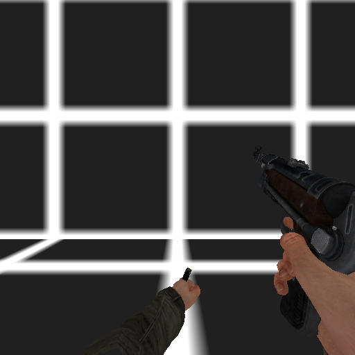

# Native captures

These frames were read from the real native GLES framebuffer on Android 15
x86_64 / SwiftShader, at 512×512. BMP captures were converted losslessly to
PNG; all pixels were compared and match. No generated images or visual
retouching are used.

| Image | Native run | Original capture | Scope |
|---|---|---|---|
| [Trainyard](native-trainyard.png) | `86c9d5c22a98` | `offscreen-trainyard-player.bmp` | Original wagon/world, actual player camera; partial diffuse rendering |
| [MP40](native-mp40.png) | `b1eef2682ddf` | `offscreen-source-mp40-idle.bmp` | Original weapon/arms/textures in the separate original `empty` test |
| [MP40 reload](native-mp40-reload.png) | `b1eef2682ddf` | `offscreen-source-mp40-reload.bmp` | Native reload pose in the same test |

Runs and binary identities are recorded in
[CHECKPOINT-VALIDATION.json](../CHECKPOINT-VALIDATION.json). These are engine
test captures, not evidence of a complete mission or retail graphics parity.

The images are published as project documentation at the owner's request.
Depicted game artwork belongs to its respective rights holders. The project's
source-code license does not license that artwork or provide game data.
